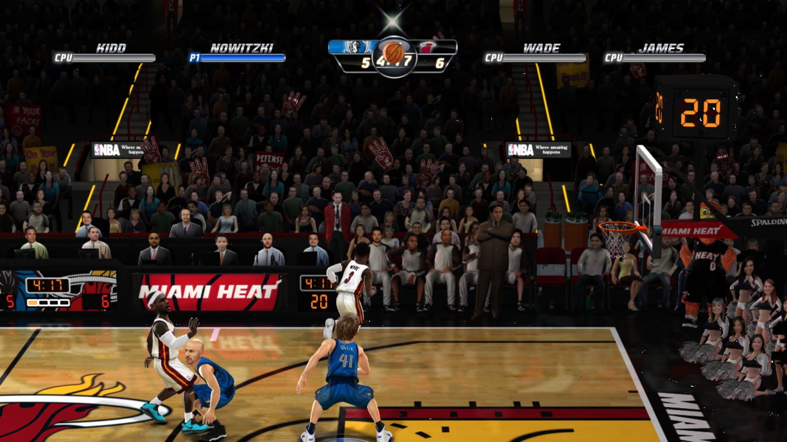
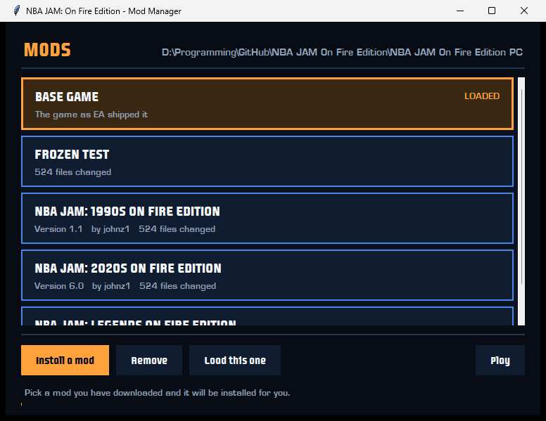
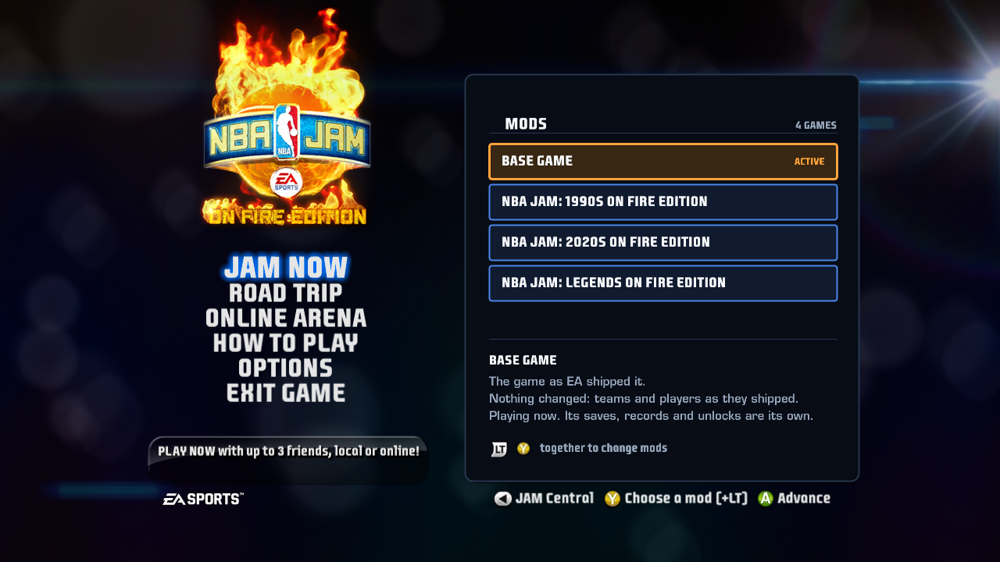
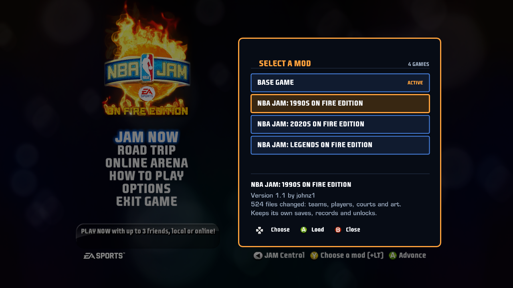
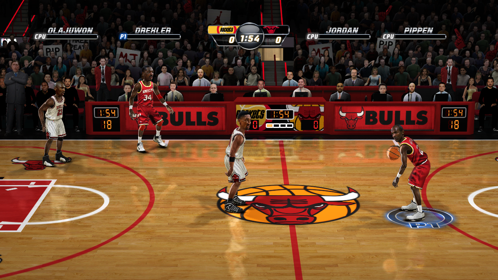

# OpenJam

> [!IMPORTANT]
> OpenJam will not receive any further updates.

A native PC port of **NBA JAM: On Fire Edition** (Xbox 360, XBLA, 2011), built
with [ReXGlue](https://github.com/rexglue/rexglue-sdk). Not an emulator: the
original PowerPC code is statically recompiled to C++ ahead of time and compiled
for x86-64.

**It runs and it plays.**



## Playing it

You need your own copy of the game. NBA JAM: On Fire Edition was sold on Xbox
Live Arcade, and a purchased copy sits on the console's drive as a single
signed container file. Nothing here ships game content and nothing here will
get you a copy.

On Windows, download the release, unzip it next to that container file, and
run **NBA JAM Mod Manager.exe**. It unpacks the game, sets the folder up, and from
then on it is the one window you need: install a mod, choose which one loads,
play. See [RELEASE.md](RELEASE.md) for what is in the download and what it
does.



### Mods

The PS3 modding scene for this game is alive and its mods run here. They are
published as PlayStation 3 packages; the manager opens one, converts its
artwork into the format this build reads, and gives it a game folder and a
save file of its own. Installed mods are listed on the game's own main menu,
in the panel where JAMnet used to be:



Hold the left trigger and press Y there and the panel wakes up: the orange box
becomes a cursor, A loads what it is on, and the game comes back up in that
mod about fifteen seconds later.

On PlayStation controllers, use **L2 + Triangle**, the d-pad, then **Cross** to
load or **Circle** to close. The chooser uses SDL on Windows and Linux, including
native DualSense Edge support. Any connected controller can open it; that pad
keeps control until it closes. Disconnecting it closes the chooser, and a
reconnected controller works without restarting. F9 opens it from the keyboard;
arrow keys, Enter and Escape select, load and close.



johnz1's 1990s edition, in play:



### Video settings

Options > Settings has a Video tab beside Audio, Gameplay and Privileges:
windowed or fullscreen, output resolution (up to 3840x2160), render scale (the
game drawn at two or three times its own resolution), picture shape, vsync
and refresh rate.
At the normal 16:9 aspect ratio, 2x draws at 2560x1440 and 3x at 3840x2160;
changing only the output size does not increase internal detail.
Output resolution, render scale and refresh rate take effect the next time
the game starts; the rest apply at once. Settings are kept in
`nbajam_ofe.toml` beside the game.

**Refresh Rate** defaults to **Original**, which keeps the existing timing.
**Match Display** uses the display the game opens on, if its current rate is
supported; otherwise it keeps the original timing. This is not an FPS unlock
and it does not change your monitor's settings. Restart after switching
displays if you want the game to pick up the new display's rate. An explicit
`video_mode_refresh_rate` override takes precedence.

The mouse cursor is hidden in the game window. The game and its menus use
controller input and do not need a pointer.

Vulkan is the default on Windows and native Linux. Windows builds include
D3D12 as an alternative: launch with `--renderer=d3d12`, or set
`renderer = "d3d12"` in `nbajam_ofe.toml`. D3D12 still has a known device-removal
failure when loading a match at higher render scales; use Vulkan for those.

**On Linux, 2x render scale is recommended. 3x is experimental and may crash.**
Mesa llvmpipe's software Vulkan driver cannot start at 3x: its buffer limit is
below the 4.5 GiB virtual buffer that scale requires. The Linux 2x smoke test
reached gameplay but logged unresolved guest memory-exhaustion traps. Linux
3x still needs hardware Vulkan validation. See the
[v1.2 release notes](RELEASE_NOTES_v1.2.md) for the full test results and limits.

### Saves and upgrades

Saves stay beside the executable: `saves/base/` for the original game and
`saves/<mod>/` for each mod. The shader cache stays in `cache/`. No
`portable.txt` is needed. Explicit command-line path overrides still work.

On the first base-game launch with no local progress, the game imports its
legacy saves from the platform's old user-data folder (`Documents/nbajam_ofe`
on Windows, including a redirected OneDrive Documents folder). It copies save
packages and their `Headers` together, along with profile data and achievements,
verifies every copied file, and then makes the complete local folder active.
The originals are retained. Existing local progress is never overwritten or
merged automatically, and base-game saves are never imported into a mod.

For an upgrade to another game folder, copy the entire `saves/` directory
before playing. To migrate manually from an older Windows installation, close
the game, back up both save locations, and copy the contents of
`Documents/nbajam_ofe/` (except `cache/`) into an empty `saves/base/` beside the
new executable. Keep the player-ID folders and `Headers` structure intact.
Do not put those base-game files in a mod's save folder.

### Download checksums and Tracy

`TracyClientrd.dll` is the [Tracy profiler](https://github.com/wolfpld/tracy)
client used by ReXGlue. The DLL shipped in OpenJam v1.1 matches the copy in the
official [ReXGlue v0.10.0 Windows SDK](https://github.com/rexglue/rexglue-sdk/releases/download/v0.10.0/rexglue-sdk-0.10.0-win-amd64.zip)
under `win-amd64/bin/TracyClientrd.dll`. Its SHA-256 is:

```text
6e5afca2b13ee999fe21c33e049576d8de951b4d0e5054aafeb7c3a906227fe8
```

The reporter in [#15](https://github.com/GTTeancum/OpenJam/issues/15#issuecomment-6761159982)
shared Kaspersky's confirmation that this detection was false and would be
corrected. Update antivirus definitions if that old detection persists.

New release packages include `SHA256SUMS.txt` for every shipped file. Packaging
also produces a `<release>.files.sha256` sidecar for publication alongside the
archive checksum, so the expected DLL hash is available without opening the
archive. Rebuilt DLLs may have different hashes: use the list for that release.
On Windows, `Get-FileHash .\TracyClientrd.dll -Algorithm SHA256` computes the
installed file's hash. On Linux, run `sha256sum -c SHA256SUMS.txt` inside the
unpacked release directory.

### Linux

There is a native Linux download. Unpack it, put your container file beside
`nbajam.sh` and run that: the first time it unpacks the game, then starts
it. Mods are installed from a terminal with `./mods.sh install <file.pkg>`,
using the same code as the Mod Manager; it needs only Python 3. The readme
inside the download has the details.

It has played whole matches, mods included, on a software Vulkan driver in
WSL. It has not yet been tried on a range of real graphics cards. Building it
needs a patched SDK; see BUILDING.md.

### Steam Deck

Either download works. The Windows release through Proton has the Mod
Manager's window: add **NBA JAM Mod Manager.exe** to Steam as a non-Steam
game, set it to run with Proton under Properties > Compatibility, and play
from there; add `nbajam_ofe.exe` the same way to go straight into the game.
Under Proton it starts fullscreen, and on a Steam Deck at 1280x800, the
Deck's own screen, so the picture fills it. That route has been played
through a whole match under Wine with vkd3d-proton and DXVK, which is what
Proton runs it with. The native Linux download can be added the same way by
pointing Steam at `nbajam.sh`. Neither has been run on a Deck itself yet.

## What this repository contains

The port project only — the configuration, hand-written source, and the tooling
built along the way. It contains **no game content**. You need your own copy of
the title; the build reads an extracted XBLA package and never redistributes it.

| Path | What it is |
| --- | --- |
| `nbajam_ofe_manifest.toml` | Entry point for codegen |
| `nbajam_ofe_config.toml` | Hand-derived function boundaries |
| `nbajam_ofe_gaps.toml` | Functions recovered from gaps discovery missed |
| `src/` | Kernel stubs, diagnostics, instruction fixups, the mod chooser, the app class |
| `tools/` | Gap recovery, guest debugging, the post-codegen instruction repair, the mod pipeline and the manager |
| `templates/` | One codegen template override |
| `RELEASE.md` | What a release contains and what a player has to provide |

`generated/` (≈166 MB, 5.7M lines) and `out/` are reproducible and not tracked.

See **[BUILDING.md](BUILDING.md)** for the toolchain, the build, how to run it,
and a full account of every local change and why it exists.

## Status

Boots to gameplay, and runs as the full version rather than a trial. Roughly
53,000 recompiled functions register with none rejected; all 320 kernel imports
resolve; graphics, audio, input and the achievement store all initialize. The
EA Sports intro video decodes correctly.

PS3 mods run on it. All three published ones install from their original
packages and play.

Known rough edges: the Xenos backend logs a stream of "invalid" texture fetch
constant warnings during play, and `memmap:\clips\` is unmapped.

## Notes

The eventual target is an original Xbox port, which inverts most of the
constraints — 64 MB unified memory against the 360's 512 MB, one 733 MHz
Pentium III against three 3.2 GHz PowerPC cores, fixed-function-era shaders
against the Xenos. This PC build exists to establish a correct reference to diff
against.

Not affiliated with or endorsed by EA, the NBA, or Microsoft. For preservation
and educational purposes.
